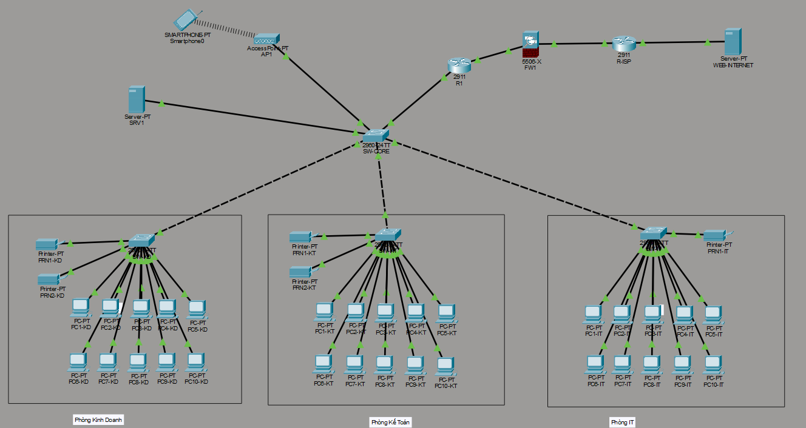
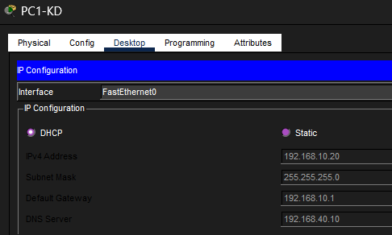
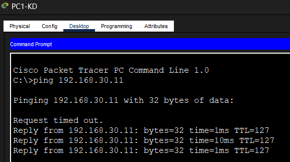
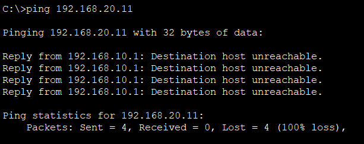
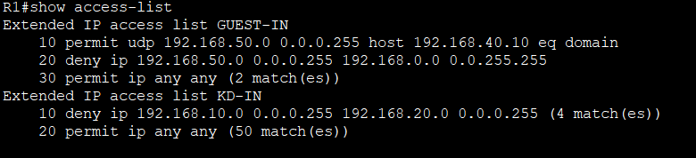
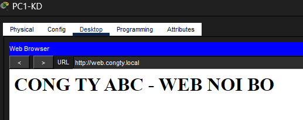
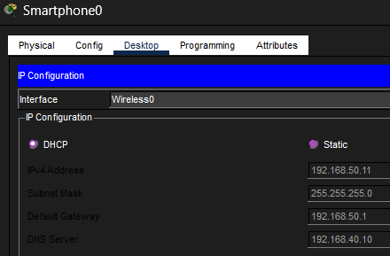
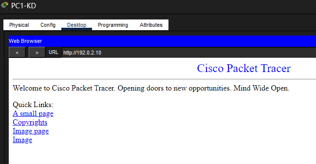
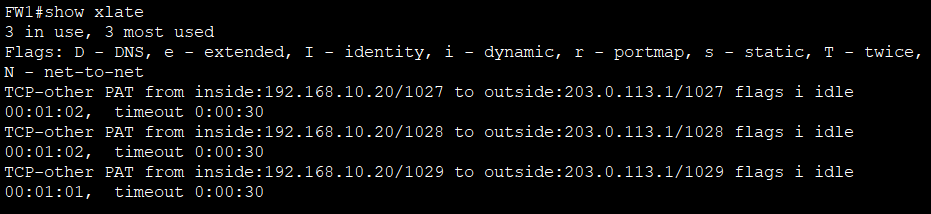
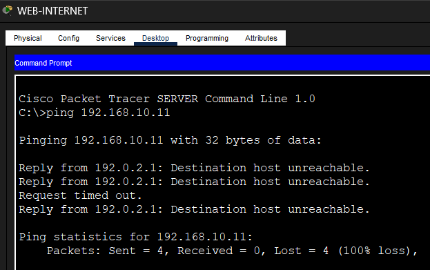

# Thiết kế mạng doanh nghiệp vừa và nhỏ (SME) bằng Cisco Packet Tracer

Mô phỏng mạng cho công ty khoảng 30-50 nhân viên gồm 3 phòng ban, 1 server nội bộ, Wi-Fi khách và kết nối Internet qua firewall có NAT.

> Dự án cá nhân phục vụ học tập, thực hiện bằng Cisco Packet Tracer. Mô hình dùng PC đại diện cho từng phòng ban; thiết kế dải /24 cho mỗi VLAN nên mở rộng được thêm nhiều máy mà không cần đổi cấu hình.

## Mục tiêu
- Chia mạng theo phòng ban bằng VLAN, tăng bảo mật và dễ quản lý
- Cấp IP tự động (DHCP), IP tĩnh cho máy in và server
- Cho các VLAN liên lạc với nhau có kiểm soát (inter-VLAN routing + ACL)
- Cung cấp dịch vụ nội bộ (DNS, HTTP) và Wi-Fi khách tách biệt
- Ra Internet qua firewall ASA với NAT/PAT
- Ghi lại quá trình xử lý sự cố thực tế

## Sơ đồ mạng


```
                         SRV1 (DNS/HTTP)   AP1 (Guest Wi-Fi)
                               \             /
SW-KD ─┐                        SW-CORE ─────┘
SW-KT ─┼── trunk ──────────────/   |
SW-IT ─┘                           R1 (router-on-a-stick, DHCP, ACL)
                                   |
                                  FW1 (ASA 5506-X, NAT/PAT)
                                   |
                                 R-ISP ── WEB-INTERNET
```

## Thiết bị
| Loại | Số lượng | Ghi chú |
|---|---|---|
| Router 2911 | 2 | R1 (nội bộ), R-ISP (giả lập nhà mạng) |
| Firewall ASA 5506-X | 1 | FW1, NAT/PAT và kiểm soát chiều ngoài vào |
| Switch 2960 | 4 | SW-CORE, SW-KD, SW-KT, SW-IT |
| PC | 30 | 10 PC mỗi phòng ban |
| Máy in | 5 | KD: 2, KT: 2, IT: 1 (IP tĩnh) |
| Server | 2 | SRV1 (nội bộ), WEB-INTERNET (giả lập Internet) |
| Access Point + Smartphone | 1 + 1 | Wi-Fi khách |

## Bảng VLAN và địa chỉ IP
| VLAN | Tên | Mạng | Gateway | Ghi chú |
|---|---|---|---|---|
| 10 | KINHDOANH | 192.168.10.0/24 | 192.168.10.1 | Máy in .5, .6 |
| 20 | KETOAN | 192.168.20.0/24 | 192.168.20.1 | Máy in .5, .6 |
| 30 | IT | 192.168.30.0/24 | 192.168.30.1 | Máy in .5 |
| 40 | SERVER | 192.168.40.0/24 | 192.168.40.1 | SRV1 = 192.168.40.10 |
| 50 | GUEST | 192.168.50.0/24 | 192.168.50.1 | Wi-Fi khách |

Liên kết ra Internet: R1 ↔ FW1 `10.0.0.0/30`, FW1 ↔ R-ISP `203.0.113.0/30`, R-ISP ↔ WEB-INTERNET `192.0.2.0/24`. Chi tiết tại [docs/ip-vlan-table.md](docs/ip-vlan-table.md).

## Công nghệ và kỹ năng thể hiện
VLAN, 802.1Q trunk, router-on-a-stick, DHCP (excluded address, pool theo VLAN), DNS, HTTP, ACL mở rộng (extended), Wi-Fi AP, NAT/PAT, firewall ASA (security-level, inspect), IP tĩnh cho máy in, xử lý sự cố bằng lệnh `show`.

## Chính sách truy cập (ACL)
- Kinh doanh (VLAN 10) **không** truy cập được Kế toán (VLAN 20)
- Khách (VLAN 50) chỉ được dùng DNS và web nội bộ, **không** vào được dải 192.168.x.x; vẫn ra Internet được
- Từ Internet **không** chủ động truy cập vào mạng nội bộ (firewall)

## Kết quả kiểm thử
| Kiểm thử | Kết quả | Ảnh |
|---|---|---|
| PC nhận IP từ DHCP | Đạt |  |
| Ping liên VLAN (KD → IT) | Thông |  |
| KD ping KT | Bị chặn bởi ACL |  |
| `show access-lists` | Có số match ở dòng deny |  |
| Web nội bộ `web.congty.local` | Truy cập được |  |
| Wi-Fi khách nhận IP 192.168.50.x | Đạt |  |
| PC ra web Internet `192.0.2.10` | Truy cập được |  |
| NAT trên firewall (`show xlate`) | Có bảng PAT |  |
| Internet ping vào mạng nội bộ | Bị chặn |  |


## Cấu trúc thư mục
```
duan_mangdoanhnghiep/
├── README.md
├── sme-network.pkt          # file Packet Tracer
├── configs/                 # running-config của từng thiết bị
├── docs/
│   ├── ip-vlan-table.md
│   ├── troubleshooting-log.md
│   └── interview-notes.md
└── screenshots/
```

